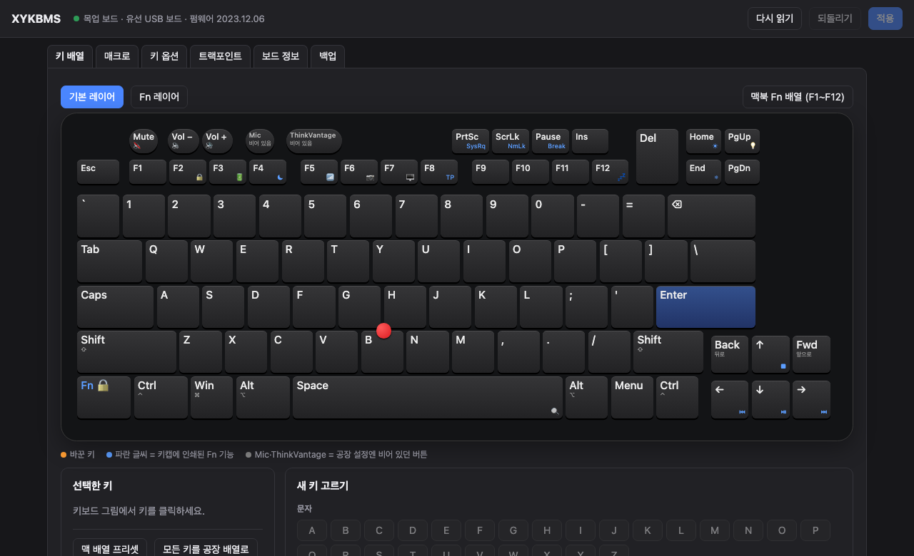

# xykbms-web

ThinkPad 클래식 키보드를 USB 키보드로 바꾸는 XY 컨트롤러 보드(`xy_3dg12`, USB VID `0x5859`)를
브라우저에서 설정하는 도구입니다.

[English](README.md)

Python으로 만든 작은 로컬 웹 서버가 HID로 보드와 통신하고, 설정은 브라우저 화면에서 바꿉니다.
윈도우 전용 `XYKBMS_SwUpdate.exe` 대신 쓸 수 있는 도구로, 자주 쓰는 설정을 다룹니다.
펌웨어 업그레이드와 핀 배치 변경은 일부러 넣지 않았습니다.



## 기능

* **키 배열 에디터**: ThinkPad X220 키보드 그림에서 키를 누르고 새 기능을 고릅니다.
  기본 레이어와 Fn 레이어(보드에 18칸)를 바꿀 수 있습니다. 배열이 보드에 저장되므로 어느 컴퓨터에서나 같습니다.
* 미디어 키, 마우스 키, F13–F24, 맥 기능(밝기, Mission Control, Spotlight 등), 그리고 버튼 한 번으로 채우는
  **맥북식 Fn 줄**(F1–F12)
* **매크로**: 프로그래머블 키 5칸. 칸마다 단축키 조합 하나(예: ⌘⇧4)를 넣을 수 있습니다.
  ThinkVantage·마이크 버튼이나 Fn 조합에 지정할 수 있고, 키보드 칩이 직접 실행합니다.
* 맥 배열 옵션: Alt ↔ Win 교체, 오른쪽 Alt → Command, Fn ↔ 왼쪽 Ctrl 교체, Win 키 비활성화
* 트랙포인트 속도, 스크롤 속도, 가운데 버튼 동작. 무선 보드는 절전·무선 설정까지
* 설정에서 읽은 보드 정보(매트릭스 크기, LED 핀, Fn 핀, Fn 레이어, 매크로)
* 쓰기 전 자동 백업, 백업 목록에서 값 불러오기

## 설치

Python 3.10 이상이 필요합니다.

```sh
git clone https://github.com/jwgo/xykbms-web.git
cd xykbms-web
python3 -m venv .venv
.venv/bin/pip install .
```

## 사용법

```sh
.venv/bin/xykbms-web              # 브라우저에서 http://127.0.0.1:8765 이 열립니다
.venv/bin/xykbms-web --mock       # 키보드 없이 시험해 보기 (목업 보드)
```

| 옵션 | |
|---|---|
| `--port N` | 다른 포트 사용 (기본 8765) |
| `--mock [CONFIG.bin]` | 목업 보드 사용. 저장해 둔 설정 파일을 주면 그 내용으로 |
| `--no-browser` | 브라우저를 자동으로 열지 않음 |

`XYKBMS_VERBOSE=1`을 주면 오가는 HID 패킷을 모두 출력하고, `XYKBMS_BACKUP_DIR`로 백업 폴더를 바꿀 수 있습니다.

바꾼 내용은 **적용**을 누르기 전까지 화면에만 있습니다. 적용을 누르면 다음 순서로 진행합니다.

1. 보드에서 설정을 새로 읽습니다.
2. 읽은 설정을 백업합니다.
3. 편집 가능한 영역만 바뀌었는지 확인합니다.
4. 설정을 씁니다.
5. 보드가 재시작하면 다시 연결합니다.
6. 다시 읽어서 바이트 단위로 비교합니다.

## 권한

**macOS**: 시스템 설정 → 개인정보 보호 및 보안 → 입력 모니터링에서 터미널(또는 Python)을 허용하세요.

**Linux** (확인 안 됨): 설정 인터페이스는 hidraw 장치라서 기본적으로 root만 열 수 있습니다.

```sh
echo 'KERNEL=="hidraw*", ATTRS{idVendor}=="5859", TAG+="uaccess"' | sudo tee /etc/udev/rules.d/70-xykbms.rules
sudo udevadm control --reload
```

그다음 키보드를 뽑았다 다시 꽂으세요.

## 안전 원칙

* 편집 가능한 영역만 바뀌었을 때만 씁니다. 편집 가능한 영역은 헤더 설정, 매트릭스 키 테이블(스캔 `0x00`–`0x7F`),
  Fn 레이어, 매크로입니다. 바뀐 키 값은 모두 알려진 값이어야 합니다.
  보드 종류, 버전, 핀 배치, Pn 영역, 알 수 없는 바이트가 하나라도 다르면 아무것도 보내기 전에 거부합니다.
* 쓰기 전에 지금 설정을 `xykbms_config-<날짜>-<시각>-<메모>.bin` 이름으로 백업 폴더에 저장합니다.

  | 시스템 | 폴더 |
  |---|---|
  | macOS | `~/Library/Application Support/XYKBMS/backups` |
  | Linux | `~/.local/share/xykbms/backups` |
  | Windows | `%APPDATA%\XYKBMS\backups` |
* 보드를 독점하지 않고 열기 때문에, 연결 중에도 미디어 키가 계속 동작합니다.
* 서버는 `127.0.0.1`에서만 열립니다. Host나 Origin이 다른 요청과 JSON이 아닌 POST는 거부합니다.
* 일부러 구현하지 않은 것: BOOT 모드, 펌웨어 업로드, 핀 배치·레이어 쓰기. 보드를 못 쓰게 만들 수 있습니다.

## 호환성

* 보드: xy_3dg12 (VID `0x5859`). 설정 화면은 설정에 저장된 보드 종류에 맞춰 바뀝니다.
* 키 배열 에디터는 보드의 핀 배치가 ThinkPad X220 클래식 기본형과 같을 때만 켜집니다.
  엉뚱한 키에 값을 쓰지 않기 위해서입니다. 다른 키보드에서도 설정·매크로·백업 화면은 쓸 수 있습니다.
* 플랫폼: macOS에서 만들고 시험했습니다. Linux와 Windows도 hidapi로 동작할 것으로 보지만 확인하지 않았습니다.

## 상태

설정 해석은 실제 X220 보드(유선 USB)에서 읽은 설정으로 확인했습니다.
단위 테스트는 목업 보드로 프로토콜, 쓰기 안전 검사, 적용 과정 전체를 검사합니다.

```sh
python3 -m unittest discover -s tests
```

아직 초기 버전입니다. 처음에는 '보드 정보' 화면부터 확인하고, 자동 백업은 지우지 말고 두세요.

## 하드웨어 메모

* 설정을 쓰면 보드가 스스로 재시작하면서 USB에서 다시 잡힙니다. 도구가 알아서 다시 연결합니다.
* 마이크 음소거 버튼(스캔 `0x67`)과 ThinkVantage 버튼(스캔 `0x07`)은 공장 키 테이블에 비어 있습니다.
  X220 매트릭스에서 스캔 번호를 계산할 수 있어서, 에디터에서 추가 키로 쓸 수 있게 했습니다.
* Insert를 6번 연속으로 누르면 보드에 내장된 설정 모드로 들어갑니다. 실수로 들어가기 쉬우니 주의하세요.
* 백라이트 명령은 동작하지만, 키보드에 백라이트 LED가 있어야 눈에 보입니다.

HID 프로토콜과 설정 구조는 [PROTOCOL.md](PROTOCOL.md)(영어)에 있습니다.

## 출처

* HID 프로토콜과 설정 구조는 윈도우 도구를 역공학한 [hughsie/xykbms-gtk](https://github.com/hughsie/xykbms-gtk)의
  `PROTOCOL.md`를 바탕으로 했습니다. 코드는 독립적으로 새로 구현했습니다.
* 마이크 음소거·ThinkVantage 버튼 위치는 ZMK의 X220 키보드 정의에 있는 키 매트릭스를 따랐습니다.

## 라이선스

LGPL-2.1-or-later. [LICENSE](LICENSE)를 보세요.
