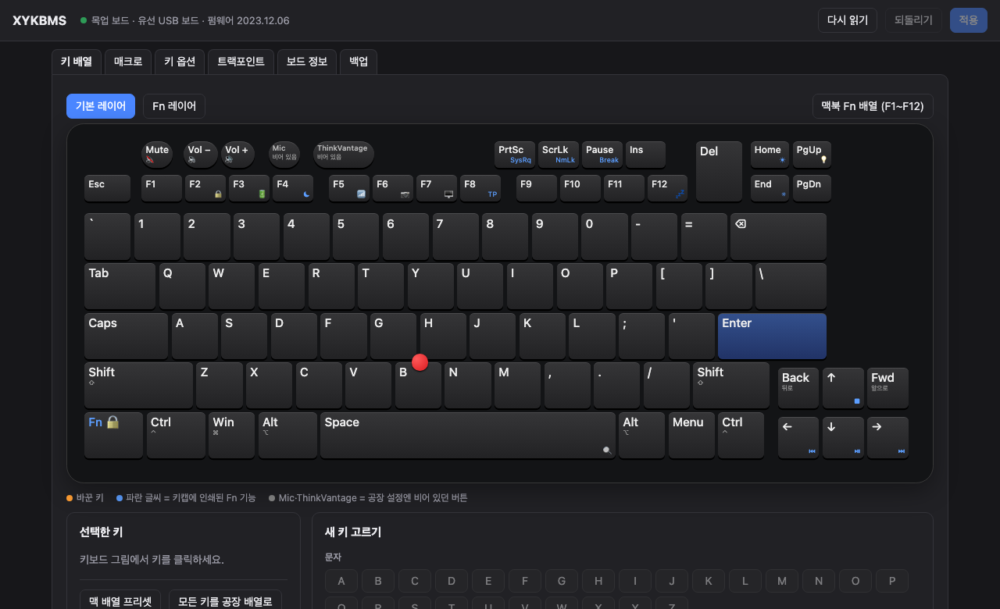

# xykbms-web

A browser-based configuration tool for the XY (`xy_3dg12`, USB VID `0x5859`) controller boards used to turn
ThinkPad classic keyboards into USB keyboards.

[한국어](README.ko.md)

It is a small local web server written in Python: it talks to the board over HID, and you edit the
settings in your browser. It is an alternative to the Windows-only `XYKBMS_SwUpdate.exe` that covers the
everyday settings and deliberately leaves out firmware upgrades and pin-map changes.



> The user interface is currently in Korean.

## Features

* **Key map editor**: click a key in a picture of the ThinkPad X220 keyboard and choose a new function.
  This works on the base layer and on the Fn layer (18 slots on the board). The map is stored in the
  board, so it works the same on any computer.
* Media keys, mouse emulation keys, F13–F24 and macOS functions (brightness, Mission Control, Spotlight, …),
  plus a one-click **MacBook-style Fn row** for F1–F12
* **Macros**: five programmable keys, each one a shortcut chord (e.g. ⌘⇧4), assignable to the ThinkVantage or
  mic-mute button or to any Fn combination. The keyboard runs them itself.
* Mac layout options: Alt ↔ Win swap, right Alt → Command, Fn ↔ left Ctrl swap, disable Win key
* TrackPoint speed, scroll speed and middle-button behaviour; power and radio settings on wireless boards
* Board information read from the config (matrix size, LED pins, Fn pin, Fn layer, macros)
* Automatic backups before every write, and a list of backups to load from

## Install

Requires Python 3.10 or newer.

```sh
git clone https://github.com/jwgo/xykbms-web.git
cd xykbms-web
python3 -m venv .venv
.venv/bin/pip install .
```

## Usage

```sh
.venv/bin/xykbms-web              # opens http://127.0.0.1:8765 in your browser
.venv/bin/xykbms-web --mock       # try it without a keyboard (simulated board)
```

| Option | |
|---|---|
| `--port N` | listen on another port (default 8765) |
| `--mock [CONFIG.bin]` | use a simulated board, optionally loaded with a saved config |
| `--no-browser` | do not open the browser |

Set `XYKBMS_VERBOSE=1` to print every HID packet, and `XYKBMS_BACKUP_DIR` to use another backup folder.

Edits stay on screen until you press **적용** (Apply). Apply then:

1. reads the config fresh from the board,
2. saves it as a backup,
3. checks that only the editable areas changed,
4. writes it,
5. waits for the board to restart and reconnects,
6. reads it back and compares it byte for byte.

## Permissions

**macOS**: allow your terminal (or Python) under System Settings → Privacy & Security → Input Monitoring.

**Linux** (untested): the configuration interface is a hidraw device, which is root-only by default.

```sh
echo 'KERNEL=="hidraw*", ATTRS{idVendor}=="5859", TAG+="uaccess"' | sudo tee /etc/udev/rules.d/70-xykbms.rules
sudo udevadm control --reload
```

Then unplug and replug the keyboard.

## Safety

* A write is only sent when nothing but the editable fields changed: the header settings, the matrix key table
  (scan index `0x00`–`0x7F`), the Fn layer and the macros. Every changed key must be a known value. The board
  type, version, pin map, Pn area and unknown bytes must stay byte-identical, or the write is refused before
  anything is sent.
* Before every write, the current config is saved to the backup folder, named `xykbms_config-<date>-<time>-<note>.bin`:

  | System | Folder |
  |---|---|
  | macOS | `~/Library/Application Support/XYKBMS/backups` |
  | Linux | `~/.local/share/xykbms/backups` |
  | Windows | `%APPDATA%\XYKBMS\backups` |
* The board is opened without seizing it, so the media keys keep working while the tool is connected.
* The server only listens on `127.0.0.1`. It rejects requests with another Host or Origin, and POSTs that are not JSON.
* Not implemented on purpose: BOOT mode, firmware upload, pin-map and layer writes. These can leave a board
  unusable.

## Compatibility

* Boards: xy_3dg12 (VID `0x5859`). The settings pages adapt to the board type stored in the config.
* The key map editor is only enabled when the board's pin map matches the stock ThinkPad X220 classic layout,
  so values are never written to the wrong keys. Other keyboards still get the settings, macro and backup pages.
* Platforms: written and tested on macOS. Linux and Windows should work through hidapi but are untested.

## Status

The config decoder was checked against configs read from a real X220 board (wired USB). The unit tests run
the protocol, the write-safety check and the whole apply path against a simulated board:

```sh
python3 -m unittest discover -s tests
```

This is a young tool. Look at the board information page first, and keep the automatic backups.

## Notes on the hardware

* After a config write the board resets itself and re-enumerates on USB; the tool reconnects on its own.
* The mic-mute button (scan `0x67`) and the ThinkVantage button (scan `0x07`) are empty in the factory key table.
  Their scan indexes follow from the X220 matrix, so the editor offers them as extra keys.
* Pressing Insert six times in a row puts the board in its built-in setup mode, which is easy to enter by accident.
* The backlight command works, but you only see it if the keyboard has backlight LEDs.

See [PROTOCOL.md](PROTOCOL.md) for the HID protocol and the config layout.

## Credits

* The HID protocol and config layout come from [hughsie/xykbms-gtk](https://github.com/hughsie/xykbms-gtk)
  (`PROTOCOL.md`), reverse engineered from the Windows tool. This is an independent implementation.
* The X220 key matrix used to place the mic-mute and ThinkVantage buttons comes from the ZMK X220 keyboard definition.

## License

LGPL-2.1-or-later, see [LICENSE](LICENSE).
